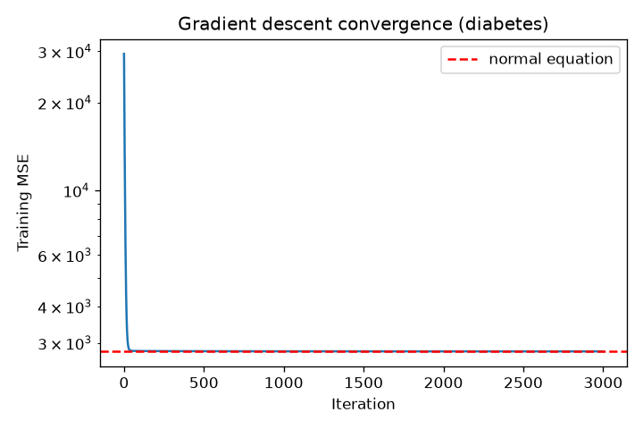
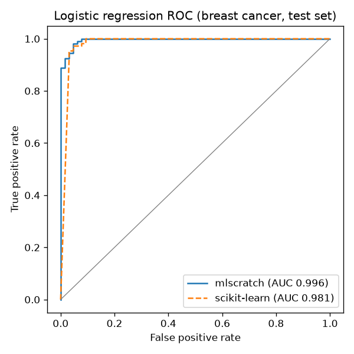
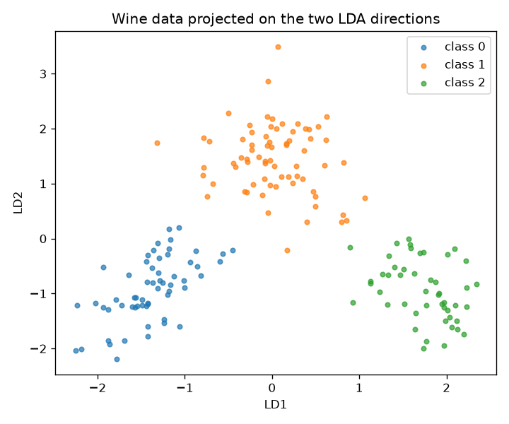

# ml-from-scratch

Classical machine learning algorithms implemented with NumPy only, each tested against scikit-learn. The goal is to make the mathematics explicit: closed-form least squares, gradient descent on the MSE and the log-likelihood, regularisation gradients, Minkowski distances, scatter matrices and the generalised eigenvalue problem behind LDA.

The algorithms come from my Machine Learning coursework at ICAI. They are reorganised here into a package with my own API, tests and benchmarks.

## What is implemented

| Module | Contents |
|---|---|
| `linear_model` | `LinearRegression` (normal equation with pseudo-inverse, or batch gradient descent), `simple_linear_regression` (closed form), `LogisticRegression` (gradient descent on the negative log-likelihood with lasso (L1), ridge (L2) or elastic-net penalties) |
| `neighbors` | `KNNClassifier` with any Minkowski distance, majority vote and class probabilities |
| `discriminant` | `LDA`: within/between-class scatter matrices, eigenvectors of S_W⁻¹S_B, projection and nearest-class-mean classification |
| `model_selection` | `k_fold_cross_validation` (k-fold and leave-one-out) |
| `metrics` | R², RMSE, MAE; confusion matrix, accuracy, precision, recall, specificity, F1; ROC curve, AUC, calibration curve |
| `preprocessing` | `one_hot_encode` for numeric or string categories |

All models follow the familiar `fit` / `predict` / `score` interface.

```python
from mlscratch import LogisticRegression

model = LogisticRegression(penalty="ridge", alpha=1.0, learning_rate=0.1, n_iterations=2000)
model.fit(X_train, y_train)
model.predict_proba(X_test)
```

## Key equations

- **Least squares:** θ = (XᵀX)⁺ Xᵀy. The pseudo-inverse keeps the solution defined when columns are collinear.
- **Gradient descent on the MSE:** ∂/∂w = (2/m) Xᵀ(Xw + b − y).
- **Logistic regression:** p = σ(Xw + b). The gradient of the mean negative log-likelihood is (1/m) Xᵀ(p − y). The penalties add (α/m)·sign(w) (lasso), (α/m)·w (ridge), or a convex combination of both (elastic net). The intercept is not penalised.
- **LDA:** S_W = Σ_c Σ_{x∈c} (x − μ_c)(x − μ_c)ᵀ and S_B = Σ_c n_c (μ_c − μ)(μ_c − μ)ᵀ. The projection uses the leading eigenvectors of S_W⁻¹S_B.

## Validation against scikit-learn

The tests (`pytest`, 31 tests) check each component against scikit-learn, SciPy or NumPy:

- k-NN predictions and k-fold scores match scikit-learn exactly.
- Normal-equation coefficients match to 1e-6.
- The LDA projection spans the same subspace as scikit-learn's (correlation above 0.999 per component).
- Metrics, ROC AUC, calibration curves and one-hot encoding match the reference implementations.

`benchmarks/compare_sklearn.py` evaluates every model on held-out data (70/30 split, standardised features):

| Model | Dataset | Metric | mlscratch | scikit-learn | Notes |
|---|---|---|---|---|---|
| Linear regression (normal equation) | Diabetes | test R² | 0.3929 | 0.3929 | max coef. difference 8.2e-13 |
| Linear regression (gradient descent) | Diabetes | test R² | 0.3924 | 0.3929 | max coef. difference 1.6 |
| Logistic regression | Breast cancer | test accuracy | 0.9532 | 0.9532 | prediction agreement 98.8 % |
| Logistic regression | Breast cancer | test ROC AUC | 0.9958 | 0.9812 | |
| k-NN (k = 5) | Wine | test accuracy | 0.9630 | 0.9630 | prediction agreement 100 % |
| LDA | Wine | test accuracy | 1.0000 | 1.0000 | |
| k-fold cross-validation | Breast cancer | mean CV accuracy | 0.9274 | 0.9274 | same standard deviation (0.0377) |

Notes on the two differences:

- **Gradient descent vs normal equation:** the diabetes features are strongly correlated, and the condition number of XᵀX/m is 472. Gradient descent therefore converges slowly along the low-curvature directions. After 3,000 iterations the predictions are almost identical (R² 0.3924 vs 0.3929), but some individual coefficients still differ.
- **Logistic regression AUC:** the reference model uses `C = 1e6`, which means almost no regularisation. The training data are linearly separable, so it fits them perfectly (training accuracy 1.0) with a weight norm of 403. The gradient-descent model stops after a fixed number of iterations, which acts as implicit regularisation (weight norm 8.5). With scikit-learn's default `C = 1` the reference AUC is 0.9956, in line with mlscratch.
- **LDA:** the two models classify differently. mlscratch assigns each sample to the nearest projected class mean, while scikit-learn uses the Gaussian Bayes rule. On this split both reach the same accuracy.

<p>



</p>

## How to run

```bash
pip install -e ".[dev]"
pytest
python benchmarks/compare_sklearn.py   # regenerates benchmarks/results.md and figures/
```

## Stack

Python and NumPy for the algorithms. scikit-learn, SciPy and pytest are used only for testing and benchmarking, and Matplotlib for the figures.
